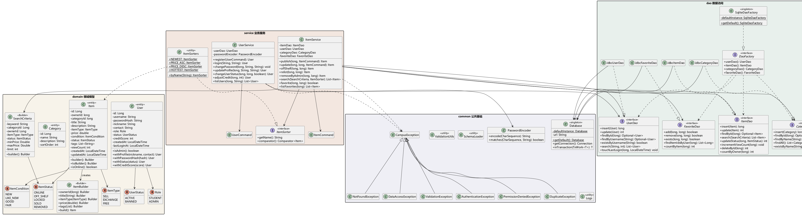
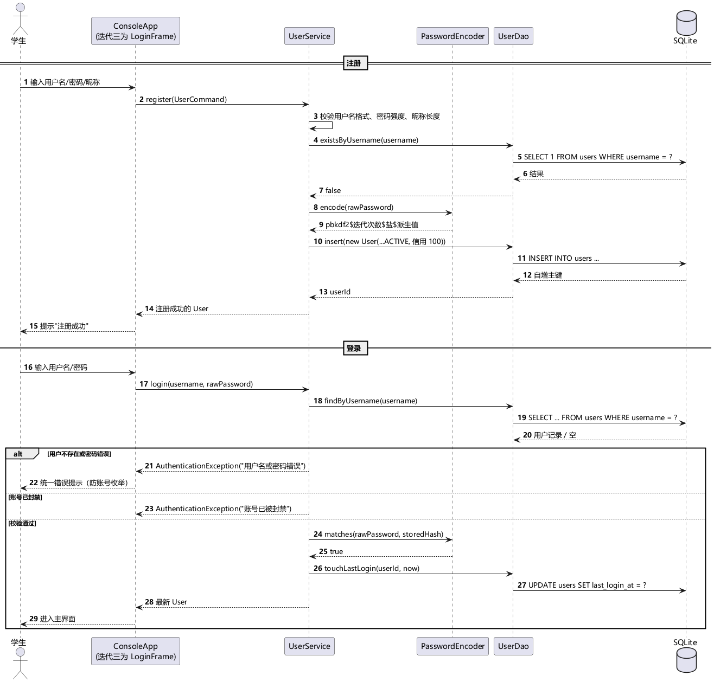
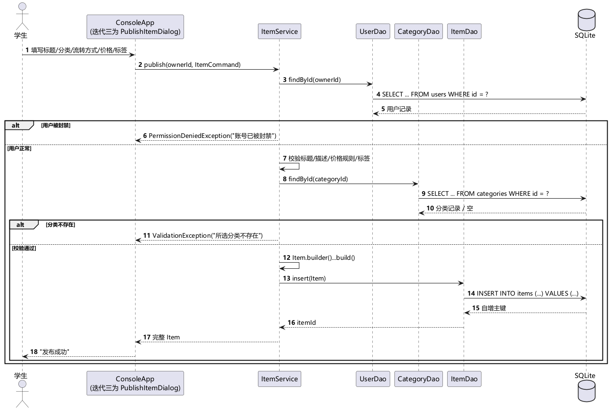

# 系统设计说明书

**项目名称**：低碳校园资源循环流转桌面系统
**文档版本**：v1.2（迭代二基线）
**对应代码**：`src/main/java/com/campusloop`（40 个源文件，约 2760 行）

---

## 1. 总体架构

系统采用典型四层架构，依赖方向严格自上而下，下层不感知上层：

```text
┌──────────────────────────────────────────────┐
│ 表现层 app（迭代二：ConsoleApp；迭代三：Swing）  │  菜单/窗口、输入采集、异常提示
├──────────────────────────────────────────────┤
│ 业务层 service（UserService / ItemService）     │  业务规则、校验、权限、事务边界
├──────────────────────────────────────────────┤
│ 数据访问层 dao（接口 + JDBC 实现 + DaoFactory） │  SQL 拼装、结果映射、异常转换
├──────────────────────────────────────────────┤
│ 领域层 domain（User/Item/Category/Status…）     │  实体、值对象、状态枚举
└──────────────────────────────────────────────┘
        ↕ 公共基础 common：Database / 校验 / 密码 / 日志 / 异常
```

**为什么这样分层**

1. 界面可替换：迭代二用控制台验证，迭代三换成 Swing 时业务层零改动（已由 `ConsoleApp` 只调用 service 证明）；
2. 存储可替换：业务层依赖 `UserDao` 等接口，换 MySQL 只需新增实现 + 换工厂；
3. 可测试：每个测试用独立临时 SQLite 库，业务规则无需启动界面即可验证。

## 2. 模块划分

| 模块 | 职责 | 关键类 | 对外接口 | 迭代 |
| --- | --- | --- | --- | --- |
| 用户模块 | 注册、登录、密码、资料、角色、封禁、信用分 | `UserService`、`User`、`Role`、`UserStatus` | `register/login/changePassword/changeUserStatus/adjustCredit` | 二 |
| 物品模块 | 发布、编辑、上下架、检索、收藏、违规下架 | `ItemService`、`Item`、`SearchCriteria`、`ItemSorter` | `publish/update/offShelf/search/favorite` | 二 |
| 分类模块 | 默认分类维护与查询 | `JdbcCategoryDao`、`Category` | `findAll/findByName` | 二 |
| 流转模块 | 意向沟通、成交记录、状态联动 | 数据表已建，服务待实现 | `trade_requests`、`trade_records` | 三 |
| 评价模块 | 双向评价、信用分更新 | 数据表已建 | `reviews` | 三 |
| 统计模块 | 分类统计、减排估算、CSV 导出 | 待实现 | `statistics` 查询 | 三/四 |
| 基础设施 | 连接、事务、校验、密码、日志、异常 | `Database`、`ValidationUtils`、`PasswordEncoder`、`Logs` | 全局 | 二 |

**模块接口约定**（迭代一确定，迭代二落地）

- 表现层只允许调用 `service` 包，禁止直接 `new JdbcXxxDao()`；
- service 只依赖 `dao` 接口与 `domain`，不导入 `java.sql`；
- 领域对象不可变，状态变更通过 `withXxx()` 生成新对象，避免共享可变状态；
- 所有对外方法对非法参数抛 `ValidationException`，业务冲突抛对应子类，SQL 异常统一转 `DataAccessException`。

## 3. UML 建模

### 3.1 类图

源文件：[`docs/uml/class-diagram.puml`](uml/class-diagram.puml)，渲染图：



要点：

- `Item` 通过内部 `Builder` 构造，必填字段在 `build()` 处 fail-fast；
- `SearchCriteria` 同为建造者，把"过滤条件"与"排序策略"解耦；
- `ItemSorter` 为策略接口，`ItemSorters` 提供 4 个内置实现（最新、价格升/降、最热）；
- `DaoFactory` 为抽象工厂接口，`SqliteDaoFactory` 为单例实现；
- `Database` 为单例，暴露 `inTransaction` 事务模板；
- 异常体系以 `CampusException` 为根，按语义细分 6 个子类。

### 3.2 时序图

| 场景 | 源文件 | 关键点 |
| --- | --- | --- |
| 用户注册与登录 | [`sequence-login.puml`](uml/sequence-login.puml) | 密码加盐哈希；登录失败统一提示防账号枚举；封禁拦截 |
| 发布物品 | [`sequence-publish.puml`](uml/sequence-publish.puml) | 先校验用户与分类，再按价格规则构造实体落库 |
| 检索与收藏 | [`sequence-search-favorite.puml`](uml/sequence-search-favorite.puml) | 动态条件 + 预编译参数；策略排序；收藏幂等 |
| 管理员强制下架 | [`sequence-admin-remove.puml`](uml/sequence-admin-remove.puml) | 管理员鉴权 + 软删除 + 操作日志 |





## 4. 设计模式应用（课程强制 ≥3 种，本项目落地 5 种）

| 模式 | 位置 | 解决的问题 | 若不用会怎样 |
| --- | --- | --- | --- |
| 单例 Singleton | `Database`、`SqliteDaoFactory` | 全局唯一数据库地址与 DAO 实例，避免重复创建 | 多处各自读配置、DAO 重复 new，配置不一致 |
| 工厂方法 / 抽象工厂 | `DaoFactory` + `SqliteDaoFactory` | 业务层按接口取 DAO，存储实现可替换 | 业务层绑定 JDBC 实现，换库要改大量代码 |
| 建造者 Builder | `Item.Builder`、`SearchCriteria.Builder`、`UserCommand` | 多参数 + 多可选字段对象的可读构造与合法性检查 | 超长构造参数、半成品对象流入数据库 |
| 策略 Strategy | `ItemSorter` / `ItemSorters` | 排序方式可扩展且与检索流程解耦 | `if-else` 堆叠，新增排序要改服务层 |
| 模板方法 Template Method | `Database.inTransaction(TxWork)` | 固定"取连接→关自动提交→提交/回滚→恢复"骨架，只暴露业务回调 | 每个写操作重复 try/catch/finally，容易漏回滚 |

> 迭代三计划补充观察者模式（物品状态变化通知界面刷新）与迭代四的简单工厂/门面（报表导出）。

## 5. 关键设计决策

1. **领域对象不可变**：`User`/`Item` 字段 final，修改用 `withXxx`/`toBuilder`。好处是线程安全、便于比较，
   也避免 DAO 查出的对象被界面随手改动后误写库。
2. **校验集中在服务层**：界面只管收集输入，服务层用 `ValidationUtils` 统一校验长度、格式、区间；
   数据库再用 CHECK/UNIQUE/外键兜底，形成"界面—服务—数据库"三层防御。
3. **密码只存派生值**：PBKDF2-HMAC-SHA256，120000 次迭代，16 字节随机盐，密文自带算法与迭代次数，
   便于将来提高参数后平滑升级；比较使用 `MessageDigest.isEqual` 常量时间比较。
4. **SQL 全部预编译**：动态检索只拼接固定片段，用户输入走 `?` 占位符；LIKE 查询对 `%`、`_`、`\` 转义，
   既防注入也防止用户输入 `%` 误匹配全表。
5. **软删除**：管理员下架置为 `REMOVED` 而非物理删除，保留流转与审计线索；只有开发调试用的
   `ItemDao.deleteById` 做物理删除（并有测试覆盖级联清理）。
6. **时间以 ISO-8601 文本存储**：SQLite 无日期类型，统一 `LocalDateTime.toString()`，排序与跨库迁移稳定。
7. **日志不侵入业务**：`Logs` 统一配置 JUL（控制台 + `logs/campusloop.log`），只记录登录、发布、
   下架、封禁、强制移除等关键动作；日志初始化失败自动降级为仅控制台，不影响主流程。

## 6. 异常处理策略

| 异常 | 触发场景 | 表现层处理 |
| --- | --- | --- |
| `ValidationException` | 输入不合法（含字段名） | 提示并定位到具体输入项 |
| `DuplicateException` | 用户名/分类名重复 | 提示"已存在" |
| `AuthenticationException` | 登录失败、原密码错误、账号封禁 | 统一提示，不泄露账号是否存在 |
| `PermissionDeniedException` | 越权编辑/下架、非管理员调用后台 | 提示无权限 |
| `NotFoundException` | id 查不到 | 提示数据不存在，建议刷新 |
| `DataAccessException` | SQL/连接/约束失败 | 提示"操作失败"，详细堆栈写日志 |

约定：DAO 不抛受检异常，统一包装为 `DataAccessException`；业务异常不打印堆栈，日志只记关键上下文。

## 7. 数据库与事务

- 每操作独立连接（`DriverManager` 短连接），连接建立即 `PRAGMA foreign_keys = ON`；
- 写操作若涉及多条 SQL（迭代三的"成交 + 改状态 + 记流水"）统一走 `Database.inTransaction`，
  失败自动回滚并抛出原始业务异常；
- 测试覆盖了提交、SQL 失败回滚、业务异常回滚三种路径（`DatabaseTest`）。

## 8. 可扩展性设计（为迭代三/四预留）

| 扩展点 | 预留方式 |
| --- | --- |
| Swing 界面 | service 方法均返回实体或列表，可直接绑定 JTable/卡片；异常信息可直接弹窗 |
| 流转状态机 | `ItemStatus.LOCKED/SOLD` 已定义，`trade_records` 表已建 |
| 信用评价 | `UserService.adjustCredit` 已实现区间截断，评价模块直接调用 |
| CSV 导出 | `Items` 列表可直接序列化，`common.util` 可加 `CsvWriter` |
| 备份恢复 | SQLite 单文件，复制 `data/campusloop.db` 即完成备份 |
| 换数据库 | 新增 `MysqlDaoFactory` 即可，业务层不动 |

## 9. 代码规范

- 包名小写、类名大驼峰、常量全大写；方法单一职责，服务方法 ≤ 60 行；
- 公共类与关键方法写 Javadoc，说明"为什么"而不只是"做什么"；
- 禁止魔法值：价格上限、标签上限、默认信用分抽为常量；
- 捕获异常必须处理或转换，禁止空 catch（回滚失败等可忽略场景需注释说明）；
- 单元测试命名 `方法_场景_期望` 风格，使用 `@DisplayName` 写中文用例说明。
